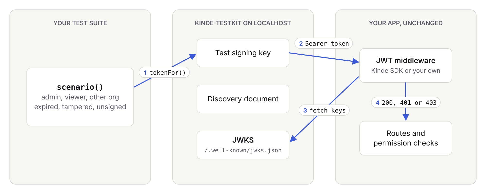
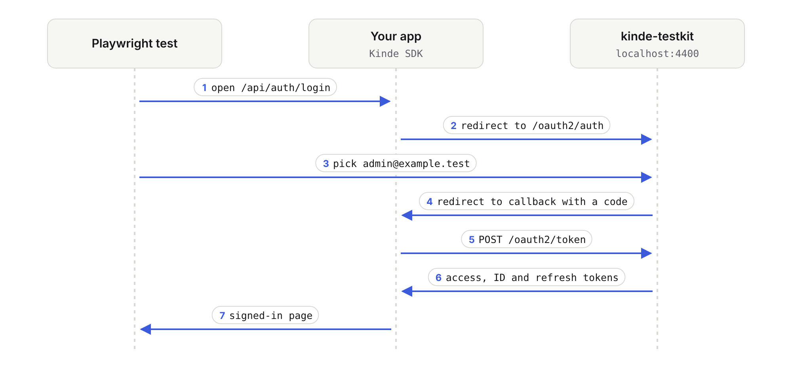

# kinde-testkit

[](https://github.com/sholajegede/kinde-testkit/actions/workflows/ci.yml) [](https://www.npmjs.com/package/kinde-testkit)

Test apps that use Kinde without a live Kinde environment. kinde-testkit runs a small issuer on localhost that does what your app needs from Kinde during a test: a sign-in page with test users, the OAuth endpoints Kinde's SDKs call, and access tokens that look like Kinde's, signed with a local key. Your app runs its real Kinde SDK and its real JWT checks against it.

There are two ways to use it:

- **API and unit tests:** mint a token for any user, organization and permission set, including expired, tampered and unsigned tokens, and send it to your API.
- **Browser tests:** point your app at the testkit, and Playwright or Cypress signs in as any seeded user through your app's own login route.

It also issues machine-to-machine tokens, answers the Management API and Account API calls your app makes, sends signed webhooks, and makes Kinde's endpoints fail or slow down on demand. A local dashboard shows what the testkit issued and answered, a coverage report shows which authentication cases your tests reached, and a `doctor` command checks your app's Kinde settings before a test run. It runs with Vitest, Jest, Playwright and Cypress, from the command line, or in Docker.

## Contents

- [Why it exists](#why-it-exists)
- [How it works](#how-it-works)
- [Install](#install)
- [Quick start with Vitest](#quick-start-with-vitest)
- [Browser tests with Playwright](#browser-tests-with-playwright)
- [Browser tests with Cypress](#browser-tests-with-cypress)
- [Machine-to-machine tokens](#machine-to-machine-tokens)
- [Webhooks](#webhooks)
- [Management API and Account API](#management-api-and-account-api)
- [Testing outages](#testing-outages)
- [Check your setup](#check-your-setup)
- [With Kinde's SDKs](#with-kindes-sdks)
- [Use with a coding agent](#use-with-a-coding-agent)
- [Checked against real Kinde](#checked-against-real-kinde)
- [Run the issuer from the command line](#run-the-issuer-from-the-command-line)
- [Dashboard](#dashboard)
- [Authentication coverage](#authentication-coverage)
- [Docker](#docker)
- [Invalid tokens](#invalid-tokens)
- [API](#api)
- [Endpoints](#endpoints)
- [Token shape](#token-shape)
- [What this release covers](#what-this-release-covers)
- [Safety](#safety)

## Why it exists

Kinde's testing guides start with a test environment, a test user with a password, and a client ID and secret in `.env`. Every test then goes through a real sign-in. That works for a few smoke tests. It gets slow and hard to run in CI once you want to test what your app does with each kind of user, such as:

- an admin and a viewer in the same organization
- one user who belongs to two organizations with different roles
- a token with no organization, or with no permissions
- a token that is expired, signed by the wrong key, issued for another audience, or not signed at all

The last group is hard to produce against a real Kinde tenant at all. These are the cases where authorization bugs hide, so kinde-testkit makes each one a single line.

## How it works



1. You describe who is calling with `scenario()`.
2. kinde-testkit signs an RS256 access token for that scenario with a key that exists only on your machine.
3. Your app gets the token in an `Authorization` header and checks it against the testkit's JWKS, the same way it checks Kinde's JWKS in production.
4. Your tests assert on what the app returns: 200, 401, 403 or 404.

Nothing is mocked inside your app. If the middleware forgets to check the audience, or a route forgets to check a permission, a test fails.

Browser sign-in follows the same flow your app uses with Kinde:



## Install

```bash
npm install --save-dev kinde-testkit
```

Node 20 or later. Working on kinde-testkit itself needs Node 22.12 or later, because its test runner, Vitest 5, does.

## Quick start with Vitest

```ts
import { describe, expect, it } from "vitest";
import { scenario } from "kinde-testkit";
import { useKindeTestkit } from "kinde-testkit/vitest";

const kinde = useKindeTestkit({ audience: "https://api.example.test" });

const admin = scenario()
  .user({ email: "admin@example.test" })
  .organization("org_acme")
  .role("admin")
  .permissions(["projects:read", "projects:delete"])
  .authenticated();

const viewer = scenario()
  .user({ email: "viewer@example.test" })
  .organization("org_acme")
  .role("viewer")
  .permissions(["projects:read"])
  .authenticated();

describe("projects API", () => {
  it("stops a viewer from deleting a project", async () => {
    const { headers } = await kinde.auth(viewer);
    const res = await app.request("/projects/p1", { method: "DELETE", headers });
    expect(res.status).toBe(403);
  });

  it("rejects an expired token", async () => {
    const { headers } = await kinde.auth(admin, { invalid: "expired" });
    const res = await app.request("/projects", { headers });
    expect(res.status).toBe(401);
  });
});
```

`useKindeTestkit()` starts the issuer on a free port before the tests and stops it after. Point your app's issuer setting at `kinde.issuer` for the test run, so its middleware fetches keys from the testkit instead of Kinde.

### Jest

`kinde-testkit/jest` has the same `useKindeTestkit()` and `kindeTest()`. It works with CommonJS and ESM test files:

```js
const { scenario } = require("kinde-testkit");
const { useKindeTestkit } = require("kinde-testkit/jest");

const kinde = useKindeTestkit({ seed: "kinde-testkit.yaml" });

test("a viewer cannot delete a project", async () => {
  const { headers } = await kinde.auth(scenario().user({ email: "viewer@example.test" }).organization("org_acme").authenticated());
  const res = await request(app).delete("/projects/p1").set(headers);
  expect(res.status).toBe(403);
});
```

It uses Jest's global `beforeAll` and `afterAll`. If you turn off `injectGlobals`, pass them from `@jest/globals`: `useKindeTestkit(options, { beforeAll, afterAll })`.

## Browser tests with Playwright

Start the testkit and your app from `playwright.config.ts`, with the app's Kinde settings pointed at the testkit:

```ts
import { defineConfig } from "@playwright/test";
import type { KindeTestOptions } from "kinde-testkit/playwright";

export default defineConfig<KindeTestOptions>({
  use: {
    baseURL: "http://localhost:3000",
    kindeIssuer: "http://localhost:4400",
  },
  webServer: [
    {
      command: "npx kinde-testkit start --port 4400",
      url: "http://localhost:4400/testkit/health",
    },
    {
      command: "npm run dev",
      url: "http://localhost:3000",
      env: {
        KINDE_ISSUER_URL: "http://localhost:4400",
        KINDE_CLIENT_ID: "kinde_testkit_example",
        KINDE_CLIENT_SECRET: "testkitexampleclientsecret0000000000000000",
        KINDE_SITE_URL: "http://localhost:3000",
        KINDE_POST_LOGIN_REDIRECT_URL: "http://localhost:3000",
        KINDE_POST_LOGOUT_REDIRECT_URL: "http://localhost:3000",
      },
    },
  ],
});
```

`kinde-testkit start` loads `kinde-testkit.json` from the folder it runs in, so the seeded users are ready before the first test. The testkit accepts any client ID and secret. Kinde's Next.js SDK checks the secret's format, so use 40 to 60 letters and digits.

Then write tests with the `kinde` fixture:

```ts
import { expect, test } from "kinde-testkit/playwright";

test("a viewer cannot delete projects", async ({ page, kinde }) => {
  await kinde.signInAs("viewer@example.test");
  await page.goto("/projects");
  await expect(page.getByRole("button", { name: /Delete/ })).toHaveCount(0);
});

test("a consultant switches organization", async ({ page, kinde }) => {
  await kinde.signInAs("consultant@example.test", { org: "org_acme" });
  await kinde.switchOrganization("org_globex");
  await page.goto("/projects");
  await expect(page.getByRole("heading", { name: "org_globex projects" })).toBeVisible();
});
```

| Fixture method | What it does |
| --- | --- |
| `kinde.signInAs(email, { org })` | Opens your app's login route, signs in on the testkit page and waits until the app has the session |
| `kinde.switchOrganization(code)` | Signs the same user in again with another active organization |
| `kinde.signOut()` | Opens your app's logout route |
| `kinde.injectFailure(rule)` | Makes a testkit endpoint fail, slow down or hang. Removed when the test ends |
| `kinde.clearFailures()` | Removes the failures this test added |
| `kinde.sendWebhook(event)` | Sends a signed webhook and returns the delivery results |

The fixture uses `/api/auth/login` and `/api/auth/logout`, the Next.js SDK's routes. Set `kindeLoginPath` and `kindeLogoutPath` in `use` when your app's routes are different. Each test gets its own browser context, so tests run in parallel without sharing sessions.

A user with more than one organization needs `{ org }`, otherwise the fixture stops with an error that names the user. Signing in to an organization the user does not belong to also fails, the same way Kinde refuses it.

[`examples/nextjs`](examples/nextjs) is a working Next.js app on `@kinde-oss/kinde-auth-nextjs` with these tests.

## Browser tests with Cypress

Start the testkit from `setupNodeEvents`, and import the commands in your support file:

```ts
// cypress.config.ts
import { defineConfig } from "cypress";
import { setupKindeTestkit } from "kinde-testkit/cypress";

export default defineConfig({
  e2e: {
    baseUrl: "http://localhost:3000",
    setupNodeEvents(on, config) {
      return setupKindeTestkit(on, config, { start: { seed: "kinde-testkit.json" } });
    },
  },
});
```

```ts
// cypress/support/e2e.ts
import "kinde-testkit/cypress/support";
```

This starts the testkit on port 4400 for the run, so start your app with `KINDE_ISSUER_URL=http://localhost:4400`. If you already run `kinde-testkit start`, leave out `start`, and the commands use `KINDE_ISSUER_URL` or `http://localhost:4400`.

```ts
it("a viewer cannot delete projects", () => {
  cy.kindeSignIn("viewer@example.test");
  cy.visit("/projects");
  cy.contains("button", /Delete/).should("not.exist");
});
```

| Command | What it does |
| --- | --- |
| `cy.kindeSignIn(email, { org, loginPath })` | Signs in through your app's login route with requests, then opens the app's callback. Fast, and needs no `cy.origin()` |
| `cy.kindeSignOut({ logoutPath })` | Opens your app's logout route |
| `cy.kindeToken(options)` | Yields an access token, with the same options as `POST /testkit/token` |
| `cy.kindeInjectFailure(rule)` | Makes a testkit endpoint fail, slow down or hang. Removed when the test ends |
| `cy.kindeClearFailures()` | Removes the failures this test added |
| `cy.kindeSendWebhook(event)` | Sends a signed webhook and yields the delivery results |
| `cy.kindeReset()` | Clears sessions, failure rules, deliveries and Management API changes |

`cy.kindeSignIn()` skips the sign-in page but runs everything else your app does: its login route, its state cookie and its callback, where the app exchanges the code for tokens. To test the sign-in page itself, visit your login route and use `cy.origin("http://localhost:4400", ...)`. The example app's `cypress/e2e/auth.cy.ts` does both.

### The sign-in page

The page at `/oauth2/auth` lists the seeded users. You can also type any email address: a user that is not in the seed file signs in without an organization. A user with more than one organization picks one on the next screen, unless the app sent `org_code`.

## Machine-to-machine tokens

Backend services and AI agents authenticate with Kinde through the client credentials grant. kinde-testkit answers it at `/oauth2/token` with tokens in Kinde's M2M shape: `gty: ["client_credentials"]`, `azp` set to the client ID, `scope`, `scp` and `v: "2"`, and no `sub`. Org-scoped apps also get `org_code`.

Seed the apps your services use:

```json
{
  "organizations": [{ "code": "org_acme" }],
  "applications": [
    { "clientId": "billing_worker", "clientSecret": "billing_secret", "scopes": ["read:invoices", "write:invoices"] },
    { "clientId": "acme_agent", "organization": "org_acme", "permissions": ["read:users"], "audience": "https://api.example.test" }
  ]
}
```

A seeded app with a `clientSecret` must send that secret. A seeded app with `scopes` is granted only the requested scopes it has, so `scope` holds what was granted and `scp` holds what was asked for, as in Kinde. A client ID that is not seeded gets a token with whatever it asks for.

Your service fetches a token the same way it does from Kinde:

```bash
curl -s -X POST http://localhost:4400/oauth2/token \
  -d grant_type=client_credentials -d client_id=acme_agent -d client_secret=x \
  -d audience=https://api.example.test -d scope=read:users
```

In tests, mint one directly with `testkit.m2mToken({ clientId, organizationCode, scopes, audience })`, or run `kinde-testkit token --m2m --client-id acme_agent --scope read:users`. M2M tokens take the same `invalid` kinds as user tokens. `principalFromClaims()` reads them as `{ type: "machine", subject: <client ID> }`.

## Webhooks

Kinde sends webhooks as a signed JWT with `Content-Type: application/jwt` and a `webhook-id` header that stays the same across retries. Your endpoint checks the signature with `decodeWebhook()` from `@kinde/webhooks`, which fetches keys from your issuer. kinde-testkit sends webhooks the same way, signed with its own key, so the same handler code works in tests when `KINDE_ISSUER_URL` points at the testkit.

Add the endpoints that should receive events to the seed file, or pass `--webhook <url>` to `start`:

```json
{
  "webhooks": [
    { "url": "http://localhost:3000/api/webhooks/kinde" },
    { "url": "http://localhost:3000/api/webhooks/billing", "events": ["customer.payment_succeeded"] }
  ]
}
```

Then send events from a test or the command line:

```ts
// Vitest
const [delivery] = await kinde.webhooks.send({ type: "user.created", user: "admin@example.test" });
expect(delivery.delivered).toBe(true);

// Playwright
await kinde.sendWebhook({ type: "organization.created", organization: "org_acme", duplicate: 3 });
```

```bash
kinde-testkit webhook user.created --user admin@example.test
kinde-testkit webhook customer.payment_succeeded --data '{"customer_id":"customer_123"}'
kinde-testkit webhook --deliveries
```

kinde-testkit builds the payload for the 16 event types that `@kinde/webhooks` defines, such as `user.created`, `organization.updated`, `role.deleted` and `access_request.created`, from your seeded users, organizations, roles and permissions. Kinde does not publish payload shapes for its billing events, such as `customer.plan_assigned`, so for those you pass the `data` object yourself. `kinde-testkit webhook --types` lists both groups.

With an endpoint configured, signing in on the testkit page sends `user.authenticated`, and the first sign-in with an email that is not seeded also sends `user.created`, as Kinde does.

Delivery follows Kinde's rules. Only a `200` counts as delivered. Anything else, or no answer, is retried with the same `webhook-id`. Kinde retries over 36 hours; the testkit retries after 0, 100 and 500 milliseconds by default, so tests stay fast. Change that with `startKindeTestkit({ webhooks: { retryDelaysMs, timeoutMs } })`.

These options test the hard parts of a webhook handler:

| Option | What it tests |
| --- | --- |
| `duplicate: n` | n copies with the same `webhook-id` and `event_id`. Your handler should process the event once |
| `invalid: "bad-signature"` | A tampered signature. `decodeWebhook()` returns `null` |
| `invalid: "unknown-key"` | Signed by a key your issuer never published |
| `invalid: "unsigned"` | `alg: none` |
| `invalid: "stale"` | A valid signature on an hour-old `timestamp`, for replay checks |
| `to: url` | Send to one URL instead of the configured endpoints |

`kinde.webhooks.deliveries()`, `kinde-testkit webhook --deliveries` and `GET /testkit/webhooks/deliveries` show every attempt with its status code or error. [`examples/nextjs`](examples/nextjs) has a webhook route and Playwright tests for valid, duplicated, forged and stale events.

## Management API and Account API

Many apps call Kinde's APIs as well as signing users in. An admin page creates organizations and adds members, a signup flow creates users, and the front end asks the Account API for the current user's permissions and feature flags. kinde-testkit answers these calls from the seed, so the test checks what your code does with the result.

The Management API is at `/api/v1`. Like Kinde, it needs a machine-to-machine token for the audience `<issuer>/api`. When a seeded application has scopes, the token gets those scopes and each route checks for its own, such as `read:users` or `create:organizations`. These routes work:

| Area | Routes |
| --- | --- |
| Users | List, filter by ID or email, get, create, update (including `is_suspended`), delete |
| Organizations | List, get, create, update, delete |
| Members | List, add with roles, remove |
| Member roles and permissions | List, grant, remove |
| Roles and permissions | List, get, create, delete, and list a role's permissions |

Every change goes into the testkit's data. A user you create can sign in, a member you add gets the role's permissions in their next token, and a suspended user sees an error on the sign-in page. Each change also sends the matching webhook, such as `organization.created` or `user.deleted`, to your configured endpoints. `reset()` puts the seed back. A route the testkit does not implement answers 404 with the code `ROUTE_NOT_FOUND`, so a test never passes against an empty answer.

Kinde's official client, `@kinde/management-api-js`, forces `https://`. Start the testkit with HTTPS and run your code with the certificate it prints:

```ts
const kinde = useKindeTestkit({ seed, https: true });
```

```bash
npx kinde-testkit start --https
NODE_EXTRA_CA_CERTS=.kinde-testkit/localhost-cert.pem npm test
```

The first start writes a self-signed certificate for `localhost` and `127.0.0.1` to `.kinde-testkit/` and reuses it after that. The test suite runs the official client against the testkit without changes.

The Account API is at `/account_api/v1`. It reads the user's access token and answers for the token's active organization: `permissions`, `permission/<key>`, `roles`, `feature_flags`, `properties`, `entitlements`, `entitlement/<key>` and `portal_link`. Kinde's `@kinde/js-utils` helpers, such as `getPermissions({ forceApi: true })`, `getFlag()` and `getEntitlements()`, work against it. Add the data it returns to the seed:

```json
{
  "users": [{ "id": "kp_admin", "email": "admin@example.test", "properties": { "team": "platform" } }],
  "roles": [{ "key": "admin", "name": "Admin", "permissions": ["projects:read", "projects:delete"] }],
  "memberships": [{ "user": "kp_admin", "organization": "org_acme", "roles": ["admin"] }],
  "featureFlags": [{ "key": "new_editor", "value": false, "organizations": { "org_acme": true } }],
  "plans": [{ "key": "pro", "subscribers": ["org_acme"], "entitlements": [{ "featureKey": "seats", "limitMax": 10 }] }]
}
```

A role's permissions are added to the member's own permissions, in tokens and in both APIs. Feature flags also go into access tokens as `feature_flags`, with the organization's value when it has one.

## Testing outages

Your app should handle Kinde being slow or down. kinde-testkit can make any endpoint answer with an error, wait before answering, or never answer:

```ts
// Vitest, in the same process
kinde.failures.add({ path: "/oauth2/token", status: 503, times: 1 });

// Playwright, removed again when the test ends
await kinde.injectFailure({ path: "/.well-known/jwks.json", delayMs: 3000 });
```

```bash
kinde-testkit fail /oauth2/token --status 429 --times 3
kinde-testkit fail --list
kinde-testkit fail --clear
```

| Rule field | What it does |
| --- | --- |
| `path` | An exact path such as `/oauth2/token`, or a prefix such as `/oauth2/*` |
| `method` | Only match this HTTP method |
| `status` | Answer with this status. 429 and 503 also send `Retry-After` |
| `delayMs` | Wait this long first, up to 60 seconds |
| `hang` | Never answer, so the client hits its own timeout |
| `times` | Apply to the next n matching requests, then remove the rule |

Failure rules apply to the whole issuer, so every test using it sees them. In Playwright, put outage tests in their own project that runs after the others. [`examples/nextjs`](examples/nextjs) has an `outage` project that takes the token endpoint down during sign-in, then slows it down. `/testkit/` control endpoints never fail.

`kinde-testkit reset` (or `POST /testkit/reset`, or `kinde.reset()` in Vitest) clears sign-in codes, refresh tokens, users who signed in with an unseeded email, and failure rules.

## Check your setup

`kinde-testkit doctor` reads `.env`, `.env.local`, `.env.test` and `.env.test.local`, plus any `KINDE_` variables in your shell, and checks them against the running issuer:

```
✓ Issuer running       http://localhost:4400 answers, issuer http://localhost:4400.
✓ Discovery            The discovery document names the same issuer.
✓ JWKS                 1 RS256 signing key at /.well-known/jwks.json.
✓ Seed                 3 seeded users.
✗ KINDE_ISSUER_URL     https://acme.kinde.com is a real Kinde domain. Tests would sign in against Kinde, not the testkit.
✓ KINDE_CLIENT_ID      Set. The testkit accepts any client ID.
✗ KINDE_CLIENT_SECRET  The Next.js SDK only accepts 40 to 60 letters and digits.
✓ KINDE_SITE_URL       http://localhost:3000.
```

It exits with code 1 when a check fails, so it can run before your test suite in CI.

`kinde-testkit inspect <token>` decodes any Kinde or testkit token and says what is wrong with it. Pipe a token in, or paste one. With `--url`, it also checks the issuer and verifies the signature:

```bash
kinde-testkit token --user admin@example.test --invalid expired | kinde-testkit inspect --url http://localhost:4400
```

```
Access token

Subject        kp_admin
Organization   org_acme
Permissions    ["projects:read"]

✓ Algorithm            RS256, the algorithm Kinde signs with.
✗ Expiry               Expired 1h 0m ago.
✓ Signature            Verified against http://localhost:4400/.well-known/jwks.json.
```

## With Kinde's SDKs

Kinde's JavaScript SDKs check tokens with `@kinde/jwt-validator`, which fetches keys from `<issuer>/.well-known/jwks.json` and then compares `iss` with the issuer you configured. kinde-testkit serves the same path, and its test suite runs that validator against every token kind.

For the Next.js SDK, set the issuer to the testkit during tests:

```bash
KINDE_ISSUER_URL=http://localhost:4400
```

The SDK accepts a plain `http://localhost` issuer. Its login, callback, refresh, logout and session-ending routes all work against the testkit. Its `validateToken` accepts kinde-testkit tokens and rejects the wrong-issuer, tampered, unknown-key and unsigned kinds. It does not reject expired tokens, because the SDK handles expiry by refreshing the session.

## Use with a coding agent

Every command takes `--json` and exits with code 1 when something fails. With `--json`, errors are one JSON object, `{ "error": { "code", "message", "details" } }`, so an agent can read the result and the reason without parsing text. A typical loop:

```bash
npx kinde-testkit start --json &                      # prints the issuer URL and seed counts as JSON
npx kinde-testkit doctor --json                       # checks the app's .env against the issuer
npx kinde-testkit token --user admin@example.test --json
npx kinde-testkit inspect "$TOKEN" --json             # explains why a token was rejected
npx kinde-testkit coverage --url http://localhost:4400 --json   # lists the auth cases not tested yet
```

Point the agent at three facts: the app's `KINDE_ISSUER_URL` must be the testkit's URL during tests, users and organizations come from `kinde-testkit.json` or `kinde-testkit.yaml`, and `kinde-testkit coverage` names the missing cases with the one-line change that tests each of them.

## Checked against real Kinde

`test/contract` sends the same requests to a real Kinde business and to the testkit and fails on any field Kinde returns that the testkit does not: discovery endpoints, JWKS keys, M2M token claims, the Management API's error for a missing token, and the fields of users, organizations, roles and permissions. It only reads. Run it with an M2M app that has the `read:users`, `read:organizations`, `read:roles` and `read:permissions` scopes in a test business:

```bash
KINDE_CONTRACT_DOMAIN=https://<your-business>.kinde.com \
KINDE_CONTRACT_CLIENT_ID=<client ID> \
KINDE_CONTRACT_CLIENT_SECRET=<client secret> \
npm run test:contract
```

## Run the issuer from the command line

```bash
npx kinde-testkit start
```

```
Kinde Testkit

Local issuer started.

Issuer:        http://localhost:4400
Discovery:     http://localhost:4400/.well-known/openid-configuration
JWKS:          http://localhost:4400/.well-known/jwks
Token:         POST http://localhost:4400/testkit/token
Dashboard:     http://localhost:4400/dashboard
```

Then mint a token from another terminal:

```bash
npx kinde-testkit token --user admin@example.test --org org_acme
curl -H "Authorization: Bearer $(npx kinde-testkit token --user admin@example.test)" localhost:3000/api/projects
```

### Seed file

`start` loads the first of `kinde-testkit.json`, `.yaml`, `.yml`, `.ts`, `.mts`, `.js` and `.mjs` in the current folder. Pass `--seed <file>` to use another path. In code, `seed` takes an object or a file path. The same seed in YAML:

```yaml
users:
  - id: kp_admin
    email: admin@example.test
organizations:
  - code: org_acme
    name: Acme Inc.
memberships:
  - user: kp_admin
    organization: org_acme
    roles: [admin]
    permissions: [projects:read, projects:delete]
```

A JavaScript or TypeScript seed exports the object as its default export or as `seed`. TypeScript seeds need Node 22.18 or later, which runs TypeScript files directly. The JSON version, with every section:

```json
{
  "audience": "https://api.example.test",
  "users": [
    { "id": "kp_admin", "email": "admin@example.test", "givenName": "Ada" },
    { "id": "kp_consultant", "email": "consultant@example.test" }
  ],
  "organizations": [
    { "code": "org_acme", "name": "Acme Inc." },
    { "code": "org_globex", "name": "Globex" }
  ],
  "memberships": [
    { "user": "kp_admin", "organization": "org_acme", "roles": ["admin"], "permissions": ["projects:read", "projects:delete"] },
    { "user": "kp_consultant", "organization": "org_acme", "roles": ["viewer"], "permissions": ["projects:read"] },
    { "user": "kp_consultant", "organization": "org_globex", "roles": ["admin"], "permissions": ["projects:delete"] }
  ],
  "applications": [
    { "clientId": "acme_agent", "organization": "org_acme", "scopes": ["read:users"] }
  ],
  "webhooks": [
    { "url": "http://localhost:3000/api/webhooks/kinde" }
  ]
}
```

A token for a seeded user takes its roles and permissions from the membership in the active organization. A user with two memberships must name the organization. The issuer refuses a token for an organization the user does not belong to, because Kinde would not issue one. The issuer checks the whole seed when it starts and lists every problem at once.

`kinde-testkit seed <file>` replaces the seed of a running issuer, and `reset` returns to that seed after that. The issuer, audience and signing key stay the same, so apps that cached the keys keep working. `kinde-testkit stop` stops a running issuer.

## Dashboard

Open `http://localhost:4400/dashboard` while the testkit runs. It shows:

- users, organizations and memberships, with the permissions each member's token gets
- the latest tokens the testkit issued, with their claims
- the latest requests to Kinde's endpoints, with status and time taken. Codes, secrets and refresh tokens are hidden
- webhook deliveries, and a form to send an event
- failure rules, and a form to add one
- the coverage report

It has buttons to reset the testkit and to clear coverage. **Live updates** reloads the page every 3 seconds. The dashboard only adds a view: everything on it is also in the CLI and the HTTP endpoints. It only accepts actions from its own page, so another site you have open cannot reset or change the testkit.

## Authentication coverage

Most suites test that a user can sign in. Authorization bugs hide in the other cases: a token from another organization, an expired token, a user with no permissions. The testkit records which of these cases it produced during a run, grouped the way the bugs happen:

```bash
npx kinde-testkit coverage
```

```
Kinde authentication coverage

Identity              6/6
Organizations         4/5
Permissions           5/5
Token validation      3/8
Sessions              4/5
Machine-to-machine    0/4
Kinde APIs            2/4
Webhooks              5/5
Outages               2/4

Overall: 31/46

Not covered:
  Organizations: Organization claim missing. Mint a token with invalid: "missing-organization".
  Token validation: Wrong issuer. Mint a token with invalid: "wrong-issuer".
  ...
```

Turn it on with `useKindeTestkit({ coverage: true })` in Vitest or Jest, `setupKindeTestkit(on, config, { start: { coverage: true } })` in Cypress, or `kinde-testkit start --coverage`. Each test file writes its result to `.kinde-testkit/coverage/` when it ends, and `kinde-testkit coverage` adds them up. Clear the folder before a run with `kinde-testkit coverage --clear`, and fail CI below a number with `--min 30`. For a running issuer, `kinde-testkit coverage --url http://localhost:4400` reads it directly, and the dashboard shows the same report.

Coverage counts what the testkit produced, such as an expired token or a 503 from the token endpoint. It does not know what your test checked after that. A covered item means your suite sent that case to your app. Your assertions decide whether the app handled it.

## Docker

The repository has a Dockerfile. Build it straight from GitHub, then mount the folder with your seed file:

```bash
docker build -t kinde-testkit https://github.com/sholajegede/kinde-testkit.git
docker run --rm -p 4400:4400 -v "$PWD:/work" kinde-testkit
```

The container runs `kinde-testkit start` as a non-root user, loads the seed file from `/work`, and has a health check on `/testkit/health`. Its issuer is `http://localhost:4400`, which is right when your app and browser run on the host. In Docker Compose, where the app reaches the testkit by service name, set the issuer to the address your app uses:

```yaml
services:
  kinde:
    build: https://github.com/sholajegede/kinde-testkit.git
    command: ["start", "--host", "0.0.0.0", "--port", "4400", "--allow-public", "--issuer", "http://kinde:4400"]
    volumes: ["./:/work"]
  app:
    build: .
    environment:
      KINDE_ISSUER_URL: http://kinde:4400
    depends_on:
      kinde:
        condition: service_healthy
```

The browser must reach the same issuer address as the app, because the issuer in the token has to match. Run browser tests on the host with the `localhost` setup, or run the browser in the same Compose network.

### Commands

| Command | What it does |
| --- | --- |
| `kinde-testkit start` | Start the issuer. Options: `--port`, `--host`, `--issuer`, `--audience`, `--client-id`, `--seed`, `--webhook`, `--https`, `--cert-dir`, `--coverage`, `--allow-public`, `--json` |
| `kinde-testkit stop` | Stop a running issuer. Options: `--url` |
| `kinde-testkit seed <file>` | Replace a running issuer's seed with a JSON, YAML, JavaScript or TypeScript file. Options: `--url`, `--json` |
| `kinde-testkit cert` | Write the local HTTPS certificate and print the `NODE_EXTRA_CA_CERTS` line. Options: `--dir` |
| `kinde-testkit token` | Print a signed access token. Options: `--user`, `--org`, `--sub`, `--permissions`, `--roles`, `--expires-in`, `--invalid`, `--url`, `--json` |
| `kinde-testkit users` | List seeded users |
| `kinde-testkit organizations` | List seeded organizations |
| `kinde-testkit token --m2m` | Print a machine-to-machine token. Options: `--client-id`, `--scope`, `--org`, `--permissions`, `--expires-in`, `--invalid` |
| `kinde-testkit inspect [token]` | Decode a token and check it. Reads stdin when no token is given. Options: `--url`, `--json` |
| `kinde-testkit inspect --requests` | List the latest requests the issuer answered. `--tokens` lists the latest tokens it issued |
| `kinde-testkit coverage` | Show which authentication cases your tests covered. Options: `--url`, `--dir`, `--min`, `--clear`, `--json` |
| `kinde-testkit doctor` | Check your app's Kinde settings against the issuer. Options: `--url`, `--env-file`, `--json` |
| `kinde-testkit fail <path>` | Add a failure rule. Options: `--status`, `--delay`, `--hang`, `--times`, `--method`, `--list`, `--clear` |
| `kinde-testkit reset` | Clear sign-in sessions, failure rules, webhook deliveries, endpoints added at runtime and Management API changes |
| `kinde-testkit webhook <type>` | Send a signed webhook. Options: `--user`, `--org`, `--role`, `--permission`, `--data`, `--to`, `--duplicate`, `--invalid`, `--types`, `--deliveries` |

Every command takes `--json` for CI scripts and coding agents.

## Invalid tokens

Pass `invalid` to `tokenFor`, `token`, `kinde.auth()` or `--invalid` on the CLI.

| Kind | What changes | What your app should do |
| --- | --- | --- |
| `expired` | `exp` is one hour in the past | 401 |
| `future-iat` | `iat` is one hour in the future | 401 when you set a max token age |
| `wrong-issuer` | `iss` is a different domain | 401 |
| `wrong-audience` | `aud` is a different API | 401 |
| `bad-signature` | One byte of the signature is flipped | 401 |
| `unknown-key` | Signed by a key whose `kid` is not in the JWKS | 401 |
| `unsigned` | `alg: none` with no signature | 401 |
| `missing-subject` | No `sub` | 401 or 403 |
| `missing-organization` | No `org_code` | 403 for any organization-scoped route |
| `missing-permissions` | `permissions` is empty | 403 |

The last three verify correctly. They test your authorization code, not your signature checks.

## API

```ts
import {
  scenario,
  createKindeUser,
  createKindeOrganization,
  createMembership,
  createKindeToken,
  KindeTestkit,
  startKindeTestkit,
  principalFromClaims,
} from "kinde-testkit";
```

- `scenario()` builds a caller: `.user()`, `.organization()`, `.withoutOrganization()`, `.role()`, `.permissions()`, `.claims()`, then `.authenticated()` or `.unauthenticated()`. The result is plain JSON, so you can keep scenarios in a shared file and import them anywhere.
- `createKindeUser()` gives a user a stable id derived from the email, so the same email always maps to the same `kp_` id. `createKindeOrganization()` and `createMembership()` cover organizations and per-organization roles.
- `KindeTestkit.create({ issuer, audience, clientId, accessTokenExpiresIn, idTokenExpiresIn })` holds a signing key. Access tokens last 24 hours and ID tokens 1 hour by default, the same as Kinde's defaults. Use `token()`, `tokenFor(scenario)`, `idTokenFor(scenario)`, `m2mToken()`, `headersFor(scenario)`, `principalFor(scenario)`, `signPayload()` and `jwks()`.
- `startKindeTestkit({ port, seed, audience, https, coverage })` runs the issuer in-process and returns `{ url, issuer, jwksUri, testkit, failures, webhooks, directory, coverage, activity, loadSeed(), reset(), close() }`. `seed` is an object or a file path. Pass `webhooks: { retryDelaysMs, timeoutMs }` to change webhook retries.
- `loadSeedFile(path)` reads a JSON, YAML, JavaScript or TypeScript seed. `readCoverageDirectory()`, `formatCoverageReport()` and `CoverageRecorder` are the functions behind `kinde-testkit coverage`.
- `appLoginUrl()`, `readSignInRequest()`, `signInForm()` and `resolveLocation()` are the steps `cy.kindeSignIn()` takes, for signing in with requests from another test runner.
- `inspectToken(token, { issuerUrl })` and `runDoctor({ url, env })` are the functions behind `inspect` and `doctor`. Both return a list of checks with `pass`, `warn` or `fail`.
- `createKindeToken(options)` signs with a shared default testkit whose issuer is `http://localhost:4400`, or `KINDE_TESTKIT_ISSUER` when set.
- `principalFromClaims(claims)` turns verified claims into `{ type, subject, issuer, organization, roles, permissions }`. `type` is `"user"`, or `"machine"` for M2M tokens.

From `kinde-testkit/vitest` and `kinde-testkit/jest`: `useKindeTestkit()`, which also exposes `failures`, `webhooks`, `directory`, `coverage`, `activity`, `loadSeed()` and `reset()`, and `kindeTest()`.

From `kinde-testkit/cypress`: `setupKindeTestkit(on, config, { start, url })`. From `kinde-testkit/cypress/support`: the `cy.kinde*` commands and their types.

From `kinde-testkit/playwright`: `test` and `expect` with the `kinde` fixture, the `KindeTestOptions` type for your config, and `createKindeFixture(page, options)` for building the fixture into your own `test.extend()`.

## Endpoints

| Endpoint | What it does |
| --- | --- |
| `GET /.well-known/openid-configuration` | OIDC discovery |
| `GET /.well-known/jwks`, `/.well-known/jwks.json` | Public signing key |
| `GET /oauth2/auth` | Sign-in page. Takes `client_id`, `redirect_uri`, `response_type=code`, `state`, `scope`, `nonce`, `audience`, `org_code`, `login_hint`, `prompt=none` and PKCE |
| `POST /oauth2/token` | `authorization_code`, `refresh_token` and `client_credentials` grants. Client credentials in the body or with HTTP Basic. Refresh tokens rotate on every use |
| `GET /oauth2/v2/user_profile` | Profile for the Bearer token's user |
| `POST /oauth2/revoke` | Revokes a refresh token |
| `GET /logout?redirect=<url>` | Signs out and redirects |
| `/api/v1/...` | Management API: users, organizations, members, roles and permissions |
| `GET /account_api/v1/...` | Account API: permissions, roles, feature flags, properties and entitlements for the token's user |
| `POST /testkit/token` | Mints a token directly, used by `kinde-testkit token` |
| `GET /testkit/users`, `/testkit/organizations`, `/testkit/memberships`, `/testkit/health` | Seed data and a health check |
| `GET`, `POST`, `DELETE /testkit/failures`, `DELETE /testkit/failures/<id>` | List, add and remove failure rules |
| `POST /testkit/webhooks` | Send a webhook and return the deliveries |
| `GET /testkit/webhooks/deliveries`, `/testkit/webhooks/types` | Delivery log and the event types with built-in payloads |
| `GET`, `POST /testkit/webhooks/endpoints`, `DELETE /testkit/webhooks/endpoints/<id>` | List, add and remove webhook endpoints |
| `POST /testkit/reset` | Clear sign-in state, failure rules, webhook deliveries and Management API changes |
| `POST /testkit/seed` | Replace the seed with the JSON body |
| `POST /testkit/stop` | Stop the issuer |
| `GET`, `DELETE /testkit/coverage` | Read or clear the coverage report |
| `GET /testkit/requests`, `/testkit/tokens` | The latest requests answered and tokens issued |
| `GET /dashboard` | The dashboard |

## Token shape

Access tokens use the same claims as a real Kinde access token:

```json
{
  "amr": ["email"],
  "aud": ["https://api.example.test"],
  "auth_time": 1794346114,
  "azp": "kinde_testkit_client",
  "exp": 1794432514,
  "iat": 1794346114,
  "iss": "http://localhost:4400",
  "jti": "5ef5f45e-d8ac-40a5-934a-8dc9e7b98310",
  "org_code": "org_acme",
  "permissions": ["projects:read", "projects:create"],
  "roles": [{ "id": "role_8c6976e5b5410415", "key": "admin", "name": "Admin" }],
  "scp": ["openid", "profile", "email", "offline"],
  "sub": "kp_admin"
}
```

`org_code`, `permissions` and `roles` appear only when the scenario sets them, which is how Kinde behaves for a user with no organization or permissions. The header is `{ "alg": "RS256", "typ": "JWT", "kid": "kinde-testkit-..." }`. Every key id starts with `kinde-testkit-`, so a test token is easy to spot in logs.

ID tokens carry `amr`, `aud` (the client ID), `auth_time`, `email`, `email_verified`, `given_name`, `family_name`, `name`, `picture`, `rat`, `updated_at`, and `org_codes` when the user has an organization. Empty profile fields are left out.

## What this release covers

| Capability | Status |
| --- | --- |
| OIDC discovery document | Implemented |
| JWKS with one RS256 key, at `/.well-known/jwks` and `/.well-known/jwks.json` | Implemented |
| Access tokens with `org_code`, `permissions`, `roles`, `scp` | Implemented |
| ID tokens, with `nonce` | Implemented |
| Invalid token kinds | Implemented, 10 kinds |
| Seeded users, organizations and memberships | Implemented |
| Switching the active organization | Implemented through `org_code` or the organization picker |
| Authorization code flow with sign-in page, PKCE and `state` | Implemented |
| Refresh tokens with rotation, revocation, logout and user profile | Implemented |
| Vitest and Jest helpers, Playwright fixture, Cypress commands | Implemented. Jest runs in the test suite. Cypress's sign-in steps are tested against the Next.js SDK |
| Accepted by `@kinde/jwt-validator` and the Next.js SDK's `validateToken` | Tested |
| Sign-in, organization switching and sign-out through `@kinde-oss/kinde-auth-nextjs` | Tested in Chrome with Playwright |
| Client credentials grant with Kinde's M2M token shape, seeded and org-scoped apps | Implemented |
| Failure injection: error status, delay, hang, by path, method and count | Implemented, tested through the Next.js SDK |
| `doctor`, `inspect` and `reset` commands | Implemented |
| Management API: users, organizations, members, roles and permissions | Implemented, tested with `@kinde/management-api-js` |
| Account API: permissions, roles, feature flags, properties and entitlements | Implemented, tested with `@kinde/js-utils` |
| Seed files in JSON, YAML, JavaScript and TypeScript, replaced at runtime | Implemented |
| Dashboard, request and token log | Implemented |
| Authentication coverage report | Implemented |
| Docker image | Dockerfile in the repository |
| Passwords, MFA, social sign-in and SAML | Not emulated. The sign-in page signs in any seeded user or email directly |
| Kinde's hosted pages, such as the self-serve portal | Not emulated. `portal_link` returns a placeholder page |
| Signed webhooks for the 16 event types in `@kinde/webhooks`, billing events with your data, retries, duplicates, forged and stale events | Implemented, tested with `@kinde/webhooks` and a Next.js route |

## Safety

kinde-testkit signs a token for any identity you ask for, so it keeps to localhost:

- The issuer binds to `127.0.0.1` and refuses any other interface unless you pass `--allow-public`. The Docker image passes it, because the container's own network is where it listens. Publish the port to your machine only, as `-p 4400:4400` does.
- It makes a new signing key every time it starts. Two running issuers never share a key.
- It accepts any client ID, client secret and redirect URI, so it never needs your real app settings. That is only safe because it stays on localhost.
- Codes, refresh tokens and users who sign in with an unseeded email live in memory and are gone when it stops.
- It never reads Kinde credentials, and its tokens can never pass verification against Kinde's real JWKS.
- If you set the issuer to an `https://*.kinde.com` address, it prints a warning, because that is almost always a mistake.

## License

MIT
