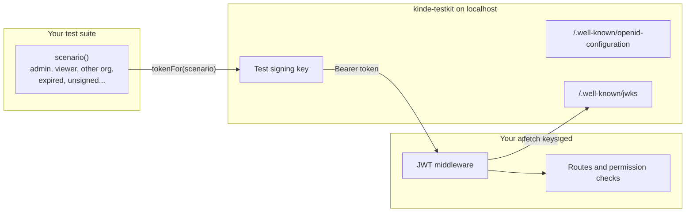

# kinde-testkit

Test apps that use Kinde without a live Kinde environment. kinde-testkit gives you test users and organizations, access tokens that look like Kinde's and are signed with a local key, and a small issuer on localhost that publishes the matching JWKS. Your app checks those tokens with the same JWT verification code it runs in production.

## Why it exists

Kinde's testing guides start with a test environment, a test user with a password, and a client ID and secret in `.env`. Every test then goes through a real sign-in. That works for a few smoke tests. It gets slow and hard to run in CI once you want to test what your app does with each kind of user, such as:

- an admin and a viewer in the same organization
- one user who belongs to two organizations with different roles
- a token with no organization, or with no permissions
- a token that is expired, signed by the wrong key, issued for another audience, or not signed at all

The last group is hard to produce against a real Kinde tenant at all. These are the cases where authorization bugs hide, so kinde-testkit makes each one a single line.

## How it works



1. You describe who is calling with `scenario()`.
2. kinde-testkit signs an RS256 access token for that scenario with a key that exists only on your machine.
3. Your app gets the token in an `Authorization` header and checks it against the testkit's JWKS, the same way it checks Kinde's JWKS in production.
4. Your tests assert on what the app returns: 200, 401, 403 or 404.

Nothing is mocked inside your app. If the middleware forgets to check the audience, or a route forgets to check a permission, a test fails.

## Install

```bash
npm install --save-dev kinde-testkit
```

Node 20 or later.

## Quick start with Vitest

```ts
import { describe, expect, it } from "vitest";
import { scenario } from "kinde-testkit";
import { useKindeTestkit } from "kinde-testkit/vitest";

const kinde = useKindeTestkit({ audience: "https://api.example.test" });

const admin = scenario()
  .user({ email: "admin@example.test" })
  .organization("org_acme")
  .role("admin")
  .permissions(["projects:read", "projects:delete"])
  .authenticated();

const viewer = scenario()
  .user({ email: "viewer@example.test" })
  .organization("org_acme")
  .role("viewer")
  .permissions(["projects:read"])
  .authenticated();

describe("projects API", () => {
  it("stops a viewer from deleting a project", async () => {
    const { headers } = await kinde.auth(viewer);
    const res = await app.request("/projects/p1", { method: "DELETE", headers });
    expect(res.status).toBe(403);
  });

  it("rejects an expired token", async () => {
    const { headers } = await kinde.auth(admin, { invalid: "expired" });
    const res = await app.request("/projects", { headers });
    expect(res.status).toBe(401);
  });
});
```

`useKindeTestkit()` starts the issuer on a free port before the tests and stops it after. Point your app's issuer setting at `kinde.issuer` for the test run, so its middleware fetches keys from `kinde.jwksUri`.

## Run the issuer from the command line

```bash
npx kinde-testkit start
```

```
Kinde Testkit

Local issuer started.

Issuer:        http://localhost:4400
Discovery:     http://localhost:4400/.well-known/openid-configuration
JWKS:          http://localhost:4400/.well-known/jwks
Token:         POST http://localhost:4400/testkit/token
```

Then mint a token from another terminal:

```bash
npx kinde-testkit token --user admin@example.test --org org_acme
curl -H "Authorization: Bearer $(npx kinde-testkit token --user admin@example.test)" localhost:3000/api/projects
```

### Seed file

When `kinde-testkit.json` exists in the current folder, `start` loads it. Pass `--seed <file>` to use another path.

```json
{
  "audience": "https://api.example.test",
  "users": [
    { "id": "kp_admin", "email": "admin@example.test", "givenName": "Ada" },
    { "id": "kp_consultant", "email": "consultant@example.test" }
  ],
  "organizations": [
    { "code": "org_acme", "name": "Acme Inc." },
    { "code": "org_globex", "name": "Globex" }
  ],
  "memberships": [
    { "user": "kp_admin", "organization": "org_acme", "roles": ["admin"], "permissions": ["projects:read", "projects:delete"] },
    { "user": "kp_consultant", "organization": "org_acme", "roles": ["viewer"], "permissions": ["projects:read"] },
    { "user": "kp_consultant", "organization": "org_globex", "roles": ["admin"], "permissions": ["projects:delete"] }
  ]
}
```

A token for a seeded user takes its roles and permissions from the membership in the active organization. A user with two memberships must name the organization. The issuer refuses a token for an organization the user does not belong to, because Kinde would not issue one. The issuer checks the whole seed when it starts and lists every problem at once.

### Commands

| Command | What it does |
| --- | --- |
| `kinde-testkit start` | Start the issuer. Options: `--port`, `--host`, `--issuer`, `--audience`, `--client-id`, `--seed`, `--allow-public`, `--json` |
| `kinde-testkit token` | Print a signed access token. Options: `--user`, `--org`, `--sub`, `--permissions`, `--roles`, `--expires-in`, `--invalid`, `--url`, `--json` |
| `kinde-testkit users` | List seeded users |
| `kinde-testkit organizations` | List seeded organizations |

Every command takes `--json` for CI scripts and coding agents.

## Invalid tokens

Pass `invalid` to `tokenFor`, `token`, `kinde.auth()` or `--invalid` on the CLI.

| Kind | What changes | What your app should do |
| --- | --- | --- |
| `expired` | `exp` is one hour in the past | 401 |
| `future-iat` | `iat` is one hour in the future | 401 when you set a max token age |
| `wrong-issuer` | `iss` is a different domain | 401 |
| `wrong-audience` | `aud` is a different API | 401 |
| `bad-signature` | One byte of the signature is flipped | 401 |
| `unknown-key` | Signed by a key whose `kid` is not in the JWKS | 401 |
| `unsigned` | `alg: none` with no signature | 401 |
| `missing-subject` | No `sub` | 401 or 403 |
| `missing-organization` | No `org_code` | 403 for any organization-scoped route |
| `missing-permissions` | `permissions` is empty | 403 |

The last three verify correctly. They test your authorization code, not your signature checks.

## API

```ts
import {
  scenario,
  createKindeUser,
  createKindeOrganization,
  createMembership,
  createKindeToken,
  KindeTestkit,
  startKindeTestkit,
  principalFromClaims,
} from "kinde-testkit";
```

- `scenario()` builds a caller: `.user()`, `.organization()`, `.withoutOrganization()`, `.role()`, `.permissions()`, `.claims()`, then `.authenticated()` or `.unauthenticated()`. The result is plain JSON, so you can keep scenarios in a shared file and import them anywhere.
- `createKindeUser()` gives a user a stable id derived from the email, so the same email always maps to the same `kp_` id. `createKindeOrganization()` and `createMembership()` cover organizations and per-organization roles.
- `KindeTestkit.create({ issuer, audience, clientId })` holds a signing key. Use `token()`, `tokenFor(scenario)`, `idTokenFor(scenario)`, `headersFor(scenario)`, `principalFor(scenario)` and `jwks()`.
- `startKindeTestkit({ port, seed, audience })` runs the issuer in-process and returns `{ url, issuer, jwksUri, testkit, close() }`.
- `createKindeToken(options)` signs with a shared default testkit whose issuer is `http://localhost:4400`, or `KINDE_TESTKIT_ISSUER` when set.
- `principalFromClaims(claims)` turns verified claims into `{ subject, issuer, organization, roles, permissions }`.

## Token shape

Access tokens carry the claims Kinde documents for its access tokens:

```json
{
  "aud": ["https://api.example.test"],
  "azp": "kinde_testkit_client",
  "exp": 1794349714,
  "iat": 1794346114,
  "iss": "http://localhost:4400",
  "jti": "5ef5f45e-d8ac-40a5-934a-8dc9e7b98310",
  "org_code": "org_acme",
  "permissions": ["projects:read", "projects:create"],
  "roles": [{ "id": "role_8c6976e5b5410415", "key": "admin", "name": "Admin" }],
  "scp": ["openid", "profile", "email", "offline"],
  "sub": "kp_admin"
}
```

The header is `{ "alg": "RS256", "typ": "JWT", "kid": "kinde-testkit-..." }`. Every key id starts with `kinde-testkit-`, so a test token is easy to spot in logs. ID tokens carry `email`, `email_verified`, `given_name`, `family_name`, `name`, `picture`, `org_codes` and `auth_time`.

## What this release covers

| Capability | Status |
| --- | --- |
| OIDC discovery document | Implemented |
| JWKS with one RS256 key | Implemented |
| Access tokens with `org_code`, `permissions`, `roles`, `scp` | Implemented |
| ID tokens | Implemented through the library |
| Invalid token kinds | Implemented, 10 kinds |
| Seeded users, organizations and memberships | Implemented |
| Switching the active organization | Implemented, one token per organization |
| Vitest helper | Implemented |
| Authorization code flow and login page | Not implemented. `/oauth2/auth` and `/oauth2/token` return 501 |
| Refresh tokens and logout | Not implemented |
| Management API and Account API | Not implemented |
| Webhooks | Not implemented |
| Playwright fixtures | Not implemented |

## Safety

kinde-testkit signs a token for any identity you ask for, so it keeps to localhost:

- The issuer binds to `127.0.0.1` and refuses any other interface unless you pass `--allow-public`.
- It makes a new signing key every time it starts. Two running issuers never share a key.
- It never reads Kinde credentials, and its tokens can never pass verification against Kinde's real JWKS.
- If you set the issuer to an `https://*.kinde.com` address, it prints a warning, because that is almost always a mistake.

## License

MIT
