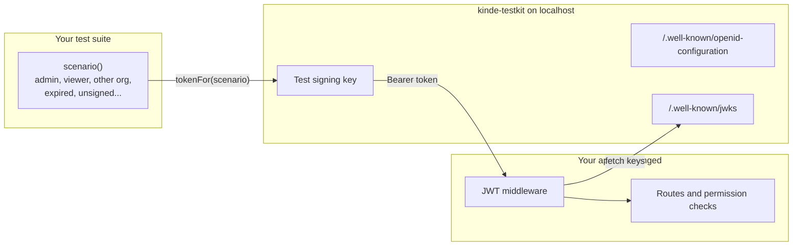
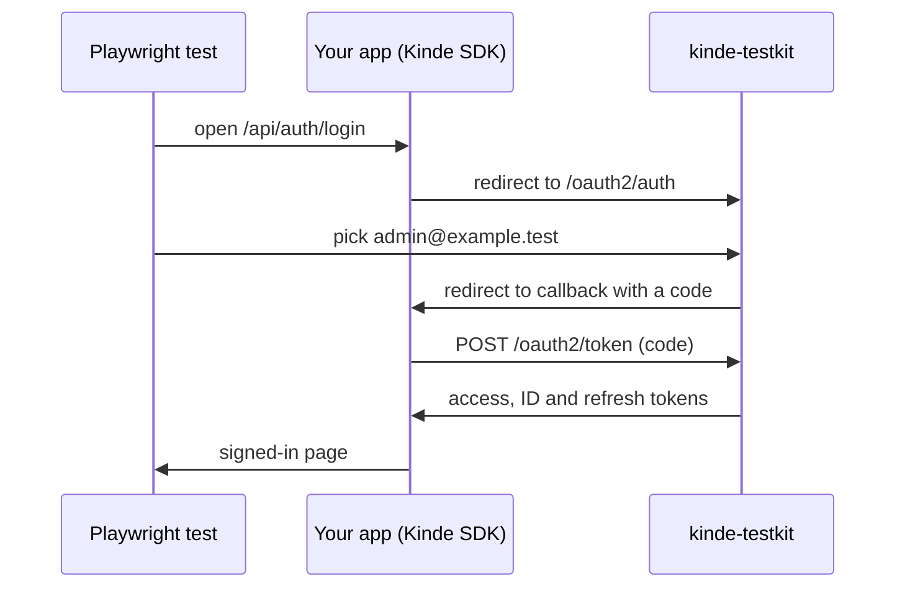

# kinde-testkit

Test apps that use Kinde without a live Kinde environment. kinde-testkit runs a small issuer on localhost that does what your app needs from Kinde during a test: a sign-in page with test users, the OAuth endpoints Kinde's SDKs call, and access tokens that look like Kinde's, signed with a local key. Your app runs its real Kinde SDK and its real JWT checks against it.

There are two ways to use it:

- **API and unit tests:** mint a token for any user, organization and permission set, including expired, tampered and unsigned tokens, and send it to your API.
- **Browser tests:** point your app at the testkit, and Playwright signs in as any seeded user through your app's own login route.

## Why it exists

Kinde's testing guides start with a test environment, a test user with a password, and a client ID and secret in `.env`. Every test then goes through a real sign-in. That works for a few smoke tests. It gets slow and hard to run in CI once you want to test what your app does with each kind of user, such as:

- an admin and a viewer in the same organization
- one user who belongs to two organizations with different roles
- a token with no organization, or with no permissions
- a token that is expired, signed by the wrong key, issued for another audience, or not signed at all

The last group is hard to produce against a real Kinde tenant at all. These are the cases where authorization bugs hide, so kinde-testkit makes each one a single line.

## How it works



1. You describe who is calling with `scenario()`.
2. kinde-testkit signs an RS256 access token for that scenario with a key that exists only on your machine.
3. Your app gets the token in an `Authorization` header and checks it against the testkit's JWKS, the same way it checks Kinde's JWKS in production.
4. Your tests assert on what the app returns: 200, 401, 403 or 404.

Nothing is mocked inside your app. If the middleware forgets to check the audience, or a route forgets to check a permission, a test fails.

Browser sign-in follows the same flow your app uses with Kinde:



## Install

```bash
npm install --save-dev kinde-testkit
```

Node 20 or later.

## Quick start with Vitest

```ts
import { describe, expect, it } from "vitest";
import { scenario } from "kinde-testkit";
import { useKindeTestkit } from "kinde-testkit/vitest";

const kinde = useKindeTestkit({ audience: "https://api.example.test" });

const admin = scenario()
  .user({ email: "admin@example.test" })
  .organization("org_acme")
  .role("admin")
  .permissions(["projects:read", "projects:delete"])
  .authenticated();

const viewer = scenario()
  .user({ email: "viewer@example.test" })
  .organization("org_acme")
  .role("viewer")
  .permissions(["projects:read"])
  .authenticated();

describe("projects API", () => {
  it("stops a viewer from deleting a project", async () => {
    const { headers } = await kinde.auth(viewer);
    const res = await app.request("/projects/p1", { method: "DELETE", headers });
    expect(res.status).toBe(403);
  });

  it("rejects an expired token", async () => {
    const { headers } = await kinde.auth(admin, { invalid: "expired" });
    const res = await app.request("/projects", { headers });
    expect(res.status).toBe(401);
  });
});
```

`useKindeTestkit()` starts the issuer on a free port before the tests and stops it after. Point your app's issuer setting at `kinde.issuer` for the test run, so its middleware fetches keys from the testkit instead of Kinde.

## Browser tests with Playwright

Start the testkit and your app from `playwright.config.ts`, with the app's Kinde settings pointed at the testkit:

```ts
import { defineConfig } from "@playwright/test";
import type { KindeTestOptions } from "kinde-testkit/playwright";

export default defineConfig<KindeTestOptions>({
  use: {
    baseURL: "http://localhost:3000",
    kindeIssuer: "http://localhost:4400",
  },
  webServer: [
    {
      command: "npx kinde-testkit start --port 4400",
      url: "http://localhost:4400/testkit/health",
    },
    {
      command: "npm run dev",
      url: "http://localhost:3000",
      env: {
        KINDE_ISSUER_URL: "http://localhost:4400",
        KINDE_CLIENT_ID: "kinde_testkit_example",
        KINDE_CLIENT_SECRET: "testkitexampleclientsecret0000000000000000",
        KINDE_SITE_URL: "http://localhost:3000",
        KINDE_POST_LOGIN_REDIRECT_URL: "http://localhost:3000",
        KINDE_POST_LOGOUT_REDIRECT_URL: "http://localhost:3000",
      },
    },
  ],
});
```

`kinde-testkit start` loads `kinde-testkit.json` from the folder it runs in, so the seeded users are ready before the first test. The testkit accepts any client ID and secret. Kinde's Next.js SDK checks the secret's format, so use 40 to 60 letters and digits.

Then write tests with the `kinde` fixture:

```ts
import { expect, test } from "kinde-testkit/playwright";

test("a viewer cannot delete projects", async ({ page, kinde }) => {
  await kinde.signInAs("viewer@example.test");
  await page.goto("/projects");
  await expect(page.getByRole("button", { name: /Delete/ })).toHaveCount(0);
});

test("a consultant switches organization", async ({ page, kinde }) => {
  await kinde.signInAs("consultant@example.test", { org: "org_acme" });
  await kinde.switchOrganization("org_globex");
  await page.goto("/projects");
  await expect(page.getByRole("heading", { name: "org_globex projects" })).toBeVisible();
});
```

| Fixture method | What it does |
| --- | --- |
| `kinde.signInAs(email, { org })` | Opens your app's login route, signs in on the testkit page and waits until the app has the session |
| `kinde.switchOrganization(code)` | Signs the same user in again with another active organization |
| `kinde.signOut()` | Opens your app's logout route |

The fixture uses `/api/auth/login` and `/api/auth/logout`, the Next.js SDK's routes. Set `kindeLoginPath` and `kindeLogoutPath` in `use` when your app's routes are different. Each test gets its own browser context, so tests run in parallel without sharing sessions.

A user with more than one organization needs `{ org }`, otherwise the fixture stops with an error that names the user. Signing in to an organization the user does not belong to also fails, the same way Kinde refuses it.

[`examples/nextjs`](examples/nextjs) is a working Next.js app on `@kinde-oss/kinde-auth-nextjs` with these tests.

### The sign-in page

The page at `/oauth2/auth` lists the seeded users. You can also type any email address: a user that is not in the seed file signs in without an organization. A user with more than one organization picks one on the next screen, unless the app sent `org_code`.

## With Kinde's SDKs

Kinde's JavaScript SDKs check tokens with `@kinde/jwt-validator`, which fetches keys from `<issuer>/.well-known/jwks.json` and then compares `iss` with the issuer you configured. kinde-testkit serves the same path, and its test suite runs that validator against every token kind.

For the Next.js SDK, set the issuer to the testkit during tests:

```bash
KINDE_ISSUER_URL=http://localhost:4400
```

The SDK accepts a plain `http://localhost` issuer. Its login, callback, refresh, logout and session-ending routes all work against the testkit. Its `validateToken` accepts kinde-testkit tokens and rejects the wrong-issuer, tampered, unknown-key and unsigned kinds. It does not reject expired tokens, because the SDK handles expiry by refreshing the session.

## Run the issuer from the command line

```bash
npx kinde-testkit start
```

```
Kinde Testkit

Local issuer started.

Issuer:        http://localhost:4400
Discovery:     http://localhost:4400/.well-known/openid-configuration
JWKS:          http://localhost:4400/.well-known/jwks
Token:         POST http://localhost:4400/testkit/token
```

Then mint a token from another terminal:

```bash
npx kinde-testkit token --user admin@example.test --org org_acme
curl -H "Authorization: Bearer $(npx kinde-testkit token --user admin@example.test)" localhost:3000/api/projects
```

### Seed file

When `kinde-testkit.json` exists in the current folder, `start` loads it. Pass `--seed <file>` to use another path.

```json
{
  "audience": "https://api.example.test",
  "users": [
    { "id": "kp_admin", "email": "admin@example.test", "givenName": "Ada" },
    { "id": "kp_consultant", "email": "consultant@example.test" }
  ],
  "organizations": [
    { "code": "org_acme", "name": "Acme Inc." },
    { "code": "org_globex", "name": "Globex" }
  ],
  "memberships": [
    { "user": "kp_admin", "organization": "org_acme", "roles": ["admin"], "permissions": ["projects:read", "projects:delete"] },
    { "user": "kp_consultant", "organization": "org_acme", "roles": ["viewer"], "permissions": ["projects:read"] },
    { "user": "kp_consultant", "organization": "org_globex", "roles": ["admin"], "permissions": ["projects:delete"] }
  ]
}
```

A token for a seeded user takes its roles and permissions from the membership in the active organization. A user with two memberships must name the organization. The issuer refuses a token for an organization the user does not belong to, because Kinde would not issue one. The issuer checks the whole seed when it starts and lists every problem at once.

### Commands

| Command | What it does |
| --- | --- |
| `kinde-testkit start` | Start the issuer. Options: `--port`, `--host`, `--issuer`, `--audience`, `--client-id`, `--seed`, `--allow-public`, `--json` |
| `kinde-testkit token` | Print a signed access token. Options: `--user`, `--org`, `--sub`, `--permissions`, `--roles`, `--expires-in`, `--invalid`, `--url`, `--json` |
| `kinde-testkit users` | List seeded users |
| `kinde-testkit organizations` | List seeded organizations |

Every command takes `--json` for CI scripts and coding agents.

## Invalid tokens

Pass `invalid` to `tokenFor`, `token`, `kinde.auth()` or `--invalid` on the CLI.

| Kind | What changes | What your app should do |
| --- | --- | --- |
| `expired` | `exp` is one hour in the past | 401 |
| `future-iat` | `iat` is one hour in the future | 401 when you set a max token age |
| `wrong-issuer` | `iss` is a different domain | 401 |
| `wrong-audience` | `aud` is a different API | 401 |
| `bad-signature` | One byte of the signature is flipped | 401 |
| `unknown-key` | Signed by a key whose `kid` is not in the JWKS | 401 |
| `unsigned` | `alg: none` with no signature | 401 |
| `missing-subject` | No `sub` | 401 or 403 |
| `missing-organization` | No `org_code` | 403 for any organization-scoped route |
| `missing-permissions` | `permissions` is empty | 403 |

The last three verify correctly. They test your authorization code, not your signature checks.

## API

```ts
import {
  scenario,
  createKindeUser,
  createKindeOrganization,
  createMembership,
  createKindeToken,
  KindeTestkit,
  startKindeTestkit,
  principalFromClaims,
} from "kinde-testkit";
```

- `scenario()` builds a caller: `.user()`, `.organization()`, `.withoutOrganization()`, `.role()`, `.permissions()`, `.claims()`, then `.authenticated()` or `.unauthenticated()`. The result is plain JSON, so you can keep scenarios in a shared file and import them anywhere.
- `createKindeUser()` gives a user a stable id derived from the email, so the same email always maps to the same `kp_` id. `createKindeOrganization()` and `createMembership()` cover organizations and per-organization roles.
- `KindeTestkit.create({ issuer, audience, clientId, accessTokenExpiresIn, idTokenExpiresIn })` holds a signing key. Access tokens last 24 hours and ID tokens 1 hour by default, the same as Kinde's defaults. Use `token()`, `tokenFor(scenario)`, `idTokenFor(scenario)`, `headersFor(scenario)`, `principalFor(scenario)` and `jwks()`.
- `startKindeTestkit({ port, seed, audience })` runs the issuer in-process and returns `{ url, issuer, jwksUri, testkit, close() }`.
- `createKindeToken(options)` signs with a shared default testkit whose issuer is `http://localhost:4400`, or `KINDE_TESTKIT_ISSUER` when set.
- `principalFromClaims(claims)` turns verified claims into `{ subject, issuer, organization, roles, permissions }`.

From `kinde-testkit/playwright`: `test` and `expect` with the `kinde` fixture, the `KindeTestOptions` type for your config, and `createKindeFixture(page, options)` for building the fixture into your own `test.extend()`.

## Endpoints

| Endpoint | What it does |
| --- | --- |
| `GET /.well-known/openid-configuration` | OIDC discovery |
| `GET /.well-known/jwks`, `/.well-known/jwks.json` | Public signing key |
| `GET /oauth2/auth` | Sign-in page. Takes `client_id`, `redirect_uri`, `response_type=code`, `state`, `scope`, `nonce`, `audience`, `org_code`, `login_hint`, `prompt=none` and PKCE |
| `POST /oauth2/token` | `authorization_code` and `refresh_token` grants. Client credentials in the body or with HTTP Basic. Refresh tokens rotate on every use |
| `GET /oauth2/v2/user_profile` | Profile for the Bearer token's user |
| `POST /oauth2/revoke` | Revokes a refresh token |
| `GET /logout?redirect=<url>` | Signs out and redirects |
| `POST /testkit/token` | Mints a token directly, used by `kinde-testkit token` |
| `GET /testkit/users`, `/testkit/organizations`, `/testkit/memberships`, `/testkit/health` | Seed data and a health check |

## Token shape

Access tokens use the same claims as a real Kinde access token:

```json
{
  "amr": ["email"],
  "aud": ["https://api.example.test"],
  "auth_time": 1794346114,
  "azp": "kinde_testkit_client",
  "exp": 1794432514,
  "iat": 1794346114,
  "iss": "http://localhost:4400",
  "jti": "5ef5f45e-d8ac-40a5-934a-8dc9e7b98310",
  "org_code": "org_acme",
  "permissions": ["projects:read", "projects:create"],
  "roles": [{ "id": "role_8c6976e5b5410415", "key": "admin", "name": "Admin" }],
  "scp": ["openid", "profile", "email", "offline"],
  "sub": "kp_admin"
}
```

`org_code`, `permissions` and `roles` appear only when the scenario sets them, which is how Kinde behaves for a user with no organization or permissions. The header is `{ "alg": "RS256", "typ": "JWT", "kid": "kinde-testkit-..." }`. Every key id starts with `kinde-testkit-`, so a test token is easy to spot in logs.

ID tokens carry `amr`, `aud` (the client ID), `auth_time`, `email`, `email_verified`, `given_name`, `family_name`, `name`, `picture`, `rat`, `updated_at`, and `org_codes` when the user has an organization. Empty profile fields are left out.

## What this release covers

| Capability | Status |
| --- | --- |
| OIDC discovery document | Implemented |
| JWKS with one RS256 key, at `/.well-known/jwks` and `/.well-known/jwks.json` | Implemented |
| Access tokens with `org_code`, `permissions`, `roles`, `scp` | Implemented |
| ID tokens, with `nonce` | Implemented |
| Invalid token kinds | Implemented, 10 kinds |
| Seeded users, organizations and memberships | Implemented |
| Switching the active organization | Implemented through `org_code` or the organization picker |
| Authorization code flow with sign-in page, PKCE and `state` | Implemented |
| Refresh tokens with rotation, revocation, logout and user profile | Implemented |
| Vitest helper and Playwright fixture | Implemented |
| Accepted by `@kinde/jwt-validator` and the Next.js SDK's `validateToken` | Tested |
| Sign-in, organization switching and sign-out through `@kinde-oss/kinde-auth-nextjs` | Tested in Chrome with Playwright |
| Client credentials (machine-to-machine) grant | Not implemented |
| Management API and Account API | Not implemented |
| Webhooks | Not implemented |

## Safety

kinde-testkit signs a token for any identity you ask for, so it keeps to localhost:

- The issuer binds to `127.0.0.1` and refuses any other interface unless you pass `--allow-public`.
- It makes a new signing key every time it starts. Two running issuers never share a key.
- It accepts any client ID, client secret and redirect URI, so it never needs your real app settings. That is only safe because it stays on localhost.
- Codes, refresh tokens and users who sign in with an unseeded email live in memory and are gone when it stops.
- It never reads Kinde credentials, and its tokens can never pass verification against Kinde's real JWKS.
- If you set the issuer to an `https://*.kinde.com` address, it prints a warning, because that is almost always a mistake.

## License

MIT
